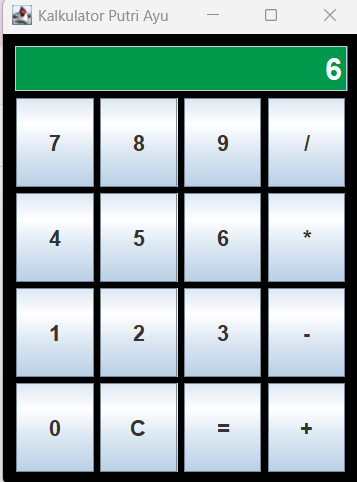

# KalkulatorGUI

Kalkulator sederhana berbasis GUI menggunakan Java Swing, dibuat untuk tugas latihan eksplorasi GUI mata kuliah Pemrograman Berorientasi Objek (PBO).

## Cara Menjalankan

1. Pastikan JDK 8 atau lebih baru sudah terpasang.
2. Compile dan jalankan file `src/KalkulatorGUI.java`.

## 5 Komponen Utama GUI

1. **Top-level Container**: `KalkulatorGUI extends JFrame`, jendela utama aplikasi.
2. **Intermediate Container**: `JPanel` (`panelUtama` dan `panelTombol`), wadah untuk mengelompokkan komponen.
3. **Atomic Component**: `JTextField` (display) dan `JButton` (tombol angka, operator, C, dan =).
4. **Layout Classes**: `BorderLayout` (mengatur display dan panel tombol) dan `GridLayout` (mengatur tombol 4x4).
5. **Event Listener**: `TombolHandler implements ActionListener` untuk klik tombol, dan `KeyAdapter` (anonymous class) yang meng-override `keyPressed()` untuk tombol Esc.
##

## Pembuat

- Nama: Putri Ayu Astuti
- NIM: F1D02510023
